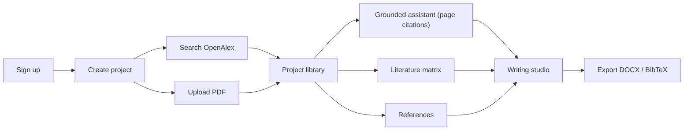

# Móyee — Stage 2: MVP Specification

**Status:** Draft for review · **Depends on:** [01-product-definition.md](./01-product-definition.md) · **Next stage:** UX Specification

**Constraints:** solo developer · 12 weeks · near-zero budget · all three personas · global · billing-ready (Paystack test mode)

---

## 1. The MVP in one sentence

> A user creates a research project, finds or uploads sources, asks questions answered **only from those sources with page-level citations**, compares sources in an editable literature matrix, and writes a referenced document they can export to DOCX.

Anything that doesn't serve this loop is out of the MVP.

---

## 2. Priority legend

- **M (Must):** the MVP fails without it. Built first.
- **S (Should):** built if the schedule allows (target weeks 10–11).
- **C (Could):** only if time is left over.
- **W (Won't):** explicitly out of the MVP. Post-launch.

---

## 3. Feature scope by module

### 3.1 Accounts & authentication
| Feature | P | Notes |
|---|---|---|
| Email + password sign-up, email verification | M | Via managed auth provider |
| Login, logout, password reset | M | |
| Profile (name, research level, discipline, default citation style) | M | Research level drives persona behaviour |
| Account deletion (cascades all data and files) | M | PRD §12.4 |
| Google sign-in | S | Usually a config toggle in managed auth |
| MFA, institutional SSO | W | |

### 3.2 Website & brand
| Feature | P | Notes |
|---|---|---|
| Landing page with fixed **Móyee** wordmark and tagline rotating every 20 s | M | Interval in one config constant. `aria-live="polite"`. Static under `prefers-reduced-motion` |
| Pricing page (Free vs Pro) | M | |
| Sign in / Sign up pages | M | |
| Privacy Policy, Terms of Service | M | Must disclose AI provider data use |
| Features / How it works sections | S | Sections of the landing page, not separate pages |
| About, Contact | C | Contact = `mailto:` link |

### 3.3 Dashboard
| Feature | P | Notes |
|---|---|---|
| Project list (title, description, created/updated, source count, status) | M | |
| Create project | M | |
| Empty state guiding the first project | M | |
| Plan usage widget | M | |
| Recent sources | S | |
| Activity feed, notification centre | W | Replaced by in-context status badges and toasts |

### 3.4 Project management
| Feature | P | Notes |
|---|---|---|
| Create / edit: name, topic, description, discipline, level, objectives, research questions, keywords | M | Feeds the AI context |
| Archive / restore, permanent delete | M | |
| Document template per project (Thesis 5-chapter, Journal article, Report, Blank) | M | Covers all three personas |
| Search projects | S | Client-side filter is enough |
| Project members / sharing | W | Keep `ProjectMember` out of the schema for now |

### 3.5 Academic discovery
| Feature | P | Notes |
|---|---|---|
| Keyword search via **OpenAlex** | M | Free, no key, global coverage |
| Filters: year range, open access only, publication type | M | |
| DOI lookup | M | OpenAlex / Crossref |
| Result details: title, authors, abstract, venue, year, DOI, OA status, citation count | M | Missing fields shown as "Not available" and never filled in |
| Save to project (creates a source + reference) | M | Records the provider |
| "Open full text" link when OA PDF URL exists | M | Link only, no automatic downloading |
| Import OA PDF into library in one click | S | Only when OpenAlex reports an OA PDF licence |
| Semantic Scholar, arXiv, PubMed | W | Provider interface designed for them |

### 3.6 Library & document processing
| Feature | P | Notes |
|---|---|---|
| PDF upload (max 20 MB, text-based) | M | |
| Validation: MIME + magic bytes, size, page cap | M | |
| Pipeline: extract per page → chunk → embed → index | M | Async, with status: queued / processing / ready / failed |
| Processing status + clear failure reason (e.g. "scanned PDF, no text layer") | M | |
| Rename, delete, download original | M | |
| Duplicate detection (file hash per project) | M | Cheap |
| Saved metadata-only sources (abstract becomes searchable) | M | Abstracts get embedded too |
| DOCX, TXT upload | S | |
| OCR for scanned PDFs | W | |
| CSV / datasets | W | |

### 3.7 Document reader
| Feature | P | Notes |
|---|---|---|
| In-browser PDF viewer with page navigation | M | |
| Jump to cited page and highlight the cited passage (from assistant/matrix citations) | M | **Core differentiator** |
| One-click summary of a document | M | Structured: aim, method, findings, limitations, each one cited |
| Search within document | S | Viewer built-in |
| Notes attached to a document/page | S | |
| Persistent user highlights | W | |

### 3.8 Research assistant (grounded RAG)
| Feature | P | Notes |
|---|---|---|
| Project-scoped chat with history (multiple conversations per project) | M | |
| Scope selector: whole project / selected sources / single document | M | |
| Answers grounded in retrieved chunks with inline citations `[1]` → document, page, passage | M | |
| Citation validation: every cited chunk ID must exist in the retrieved set, otherwise it's removed | M | Server-side |
| "Not enough evidence in your sources" response when retrieval is weak | M | Similarity threshold |
| Visual split between **From your sources** and **Móyee's interpretation** | M | PRD §6.7 |
| Streaming responses | M | |
| Hybrid retrieval (keyword + vector) | S | Postgres full-text + pgvector |
| Assistant modes: Topic & questions, Methodology advisor, Explain concept | S | Prompt presets, not separate modules (replaces PRD §6.9–6.10) |
| General-knowledge answers without sources | S | Always labelled "Not from your sources" |
| Prompt-injection protection | M | Retrieved text wrapped as untrusted data. Tested |

### 3.9 Literature review studio
| Feature | P | Notes |
|---|---|---|
| Create a matrix from selected sources (2–15 per matrix) | M | |
| AI extraction per source into fields: aim, methodology, sample, data collection, analysis, findings, limitations | M | Each cell keeps its citation, otherwise shows "Not reported" |
| Editable cells (user edits are marked as user-authored) | M | |
| Relevance column (user-written, AI suggestion optional) | M | |
| Export matrix to CSV | M | |
| Theme extraction across the matrix | S | Themes cite the sources they came from |
| Synthesis outline generation | S | |
| Potential research gaps (labelled "requires human verification") | C | |
| Draft a literature review section | C | Inserts into writing studio with citations |

### 3.10 Writing studio
| Feature | P | Notes |
|---|---|---|
| Rich-text editor (headings, lists, bold/italic, tables) | M | |
| Document created from the project template (configurable sections) | M | Users can add, rename, reorder and delete sections |
| Section outline sidebar | M | |
| Autosave | M | |
| Insert citation from project references (style-rendered) | M | |
| Auto-generated bibliography section | M | |
| AI on selection: improve clarity, fix grammar, academic tone, shorten | M | Shown as a diff, user accepts or rejects. Never adds facts or sources |
| Generate section outline | S | |
| Version history | W | |

### 3.11 References
| Feature | P | Notes |
|---|---|---|
| Auto-created from saved/uploaded sources | M | |
| Manual add/edit with missing-field warnings | M | |
| Styles: **APA 7, Harvard, IEEE** | M | Via CSL (citeproc). More styles are cheap to add later |
| MLA, Chicago | S | Just CSL files once citeproc works |
| Export BibTeX | M | |
| Export RIS, import BibTeX/RIS | S | |

### 3.12 Export
| Feature | P | Notes |
|---|---|---|
| Writing document → DOCX (headings, citations, bibliography, tables) | M | |
| Matrix → CSV, references → BibTeX | M | |
| PDF export | S | Users can convert DOCX themselves meanwhile |
| Charts in export | W | |

### 3.13 Plans, usage & billing
| Feature | P | Notes |
|---|---|---|
| Plan config table (Free, Pro) | M | Limits stored as data, not code |
| Usage metering per user per period | M | |
| Backend enforcement on every metered endpoint + friendly limit messages | M | |
| Upgrade flow via Paystack (test mode) + webhook → subscription status | M | Signature-verified |
| Billing page: current plan, usage, cancel | M | |
| Live payments, invoices, proration | W | |

### 3.14 Explicitly out of the MVP (Won't)
Collaboration · institutional plans · dataset/statistical analysis · questionnaire builder · OCR · version history · notification centre · mobile apps · recommendation engine · additional academic providers · track changes.

---

## 4. Plan limits (proposed)

Set by what free-tier AI and storage can sustain. All values are config, so they can change without a redeploy.

| Limit | Free | Pro |
|---|---|---|
| Active projects | 3 | Unlimited |
| Uploaded documents (total) | 15 | 300 |
| Storage | 100 MB | 5 GB |
| Max file size | 10 MB | 20 MB |
| Assistant messages / day | 20 | 300 |
| Academic searches / day | 30 | Unlimited (fair use) |
| Document summaries / month | 10 | 200 |
| Literature matrices | 1 per project, max 5 sources | Unlimited, max 15 sources |
| Writing AI actions / day | 15 | 200 |
| Citation styles | APA, Harvard, IEEE | All available |
| Export | DOCX, BibTeX, CSV | + PDF, RIS (when released) |

**Pro pricing (confirmed placeholder):** US\$10/month, ~US\$96/year (20% annual discount). Local-currency equivalents shown at checkout. To validate in user research.

---

## 5. Non-functional MVP bar

| Area | Requirement |
|---|---|
| Security | Every query filtered by owner via server-side checks + database row-level security. Private file storage with short-lived signed URLs |
| Isolation test | Automated tests prove user B can't read user A's projects, files, chunks or conversations |
| Performance | Page loads < 2 s on typical connections. First assistant token < 4 s. 20-page PDF processed < 60 s |
| Accessibility | Keyboard navigable, WCAG AA contrast, reduced motion respected |
| Reliability | Failed processing jobs can be retried by the user. Daily DB backups (provider default) |
| Observability | Error tracking (free tier) + log of AI token usage per request |
| AI quality | 30-question evaluation set across 5 sample papers. Target ≥ 90% citation correctness, 0 fabricated sources |

---

## 6. 12-week build plan

Weeks 1–10 build features. Weeks 11–12 are hardening plus your final-year report and defence prep.

| Week | Milestone | Deliverables |
|---|---|---|
| 1 | **Foundation** | Repos, stack set up, DB schema v1, auth, deploy pipeline (live from day 1) |
| 2 | **Projects & shell** | App layout, dashboard, project CRUD, templates, profile |
| 3 | **Discovery** | OpenAlex search, filters, DOI lookup, save to project, references auto-created |
| 4 | **Ingestion** | PDF upload, validation, storage, async extraction → chunks → embeddings, status UI |
| 5 | **Reader + summaries** | PDF viewer, cited summary, jump-to-page highlighting |
| 6 | **Assistant core** | RAG pipeline, AI provider abstraction, streaming chat, citation validation, conversations |
| 7 | **Assistant quality** | Hybrid retrieval, insufficient-evidence handling, injection defence, eval set v1 |
| 8 | **Literature matrix** | Source selection, cited extraction, editable grid, CSV export |
| 9 | **Writing studio** | Editor, template sections, autosave, citation insertion, bibliography, AI selection actions |
| 10 | **Export + billing** | DOCX export, BibTeX, plans/usage enforcement, Paystack test checkout + webhook |
| 11 | **Hardening** | Landing/pricing/legal pages, isolation + security tests, eval run, bug fixing, Should-items if ahead |
| 12 | **Launch & defence** | Usability test with 5–8 users (mix of personas), fixes, demo script, documentation |

> [!IMPORTANT]
> **Cut order if behind schedule:** (1) Should-items, (2) matrix theme extraction, (3) writing AI actions, (4) Paystack checkout (keep plan enforcement only). **Never cut:** grounded citations, data isolation, DOCX export.

---

## 7. MVP acceptance criteria (mapped from PRD §18)

| # | Criterion | Covered by |
|---|---|---|
| 1 | Secure registration and access | 3.1 |
| 2 | Create and manage projects | 3.4 |
| 3 | Search publications via integrated provider | 3.5 (OpenAlex) |
| 4 | Save publications to a project | 3.5 |
| 5 | Upload and process documents | 3.6 (PDF) |
| 6 | Ask questions about document content | 3.8 |
| 7 | Grounded responses with evidence references | 3.8 citation validation |
| 8 | Compare multiple sources | 3.9 matrix |
| 9 | Create and edit a literature matrix | 3.9 |
| 10 | Create and edit research documents | 3.10 |
| 11 | Manage references | 3.11 |
| 12 | Export documents | 3.12 DOCX |
| 13 | Enforce free and paid entitlements | 3.13 |
| 14 | No cross-user data access | §5 isolation tests |
| 15 | Clear error and processing states | 3.6, 3.13 |
| 16 | Brand displayed correctly (Móyee with accent) | 3.2 |
| 17 | Tagline rotates every 20 s | 3.2 |
| 18 | Passes functional, security, usability tests | Weeks 11–12 |

---

## 8. Stage decisions (confirmed)

1. **Citation styles:** APA 7, Harvard, IEEE ✅
2. **Templates:** Thesis (5-chapter), Journal article, Report, Blank ✅
3. **Plan limits:** accepted as placeholders. **Pro = US\$10/month** ✅
4. **Deadline:** none fixed. The plan uses relative weeks, starting week of 2026-11-09.
