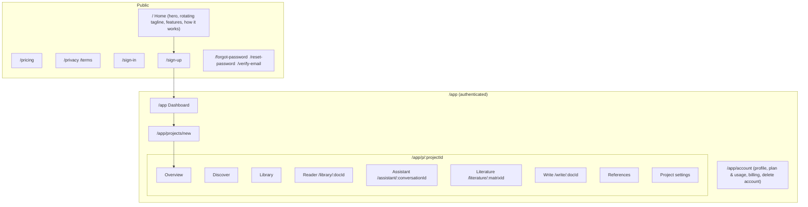
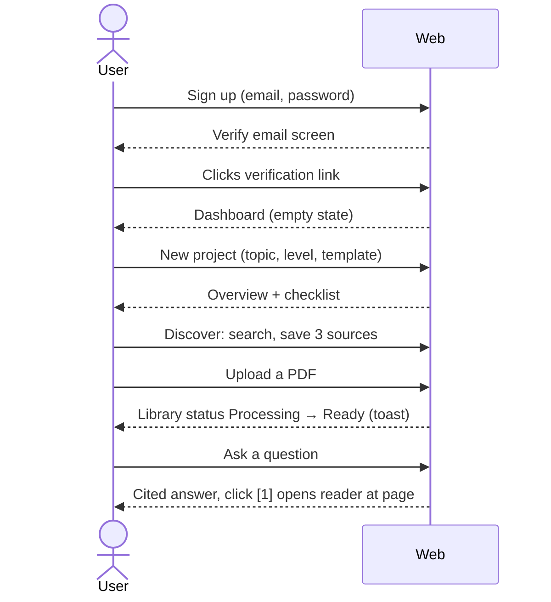

# Móyee — Stage 3: UX Specification

**Status:** Draft · **Depends on:** [02-mvp-specification.md](./02-mvp-specification.md) · **Next:** Technical Architecture

---

## 1. Design direction

| Aspect | Decision |
|---|---|
| Feel | Calm, scholarly, modern. Lots of whitespace, few colours, content first |
| Primary colour | Deep indigo `#3B3B98` (trust and intelligence) |
| Accent | Warm amber `#E8A33D` (curiosity). Used sparingly for highlights and citations |
| Neutrals | Slate scale. Background `#FAFAF9`, text `#1C1917` |
| Evidence colours | **From your sources** = indigo-tinted panel · **Móyee's interpretation** = neutral panel with an "AI interpretation" label |
| Typography | Headings: *Fraunces* (serif, academic character) · UI/body: *Inter* · Reading/editor: *Source Serif 4* |
| Wordmark | "Móyee" in Fraunces SemiBold. The **ó** is never dropped (UTF-8 everywhere, explicit `lang="en"`) |
| Components | shadcn/ui on Tailwind. Light mode for the MVP (dark mode deferred) |
| Motion | 150–250 ms ease-out. All motion turned off under `prefers-reduced-motion` |

---

## 2. Site map



---

## 3. App shell & navigation

```
┌──────────────────────────────────────────────────────────────────────┐
│ Móyee   ▸ Project: "Climate & Food Security" ▾       [Usage] [Avatar]│  top bar
├────────────┬─────────────────────────────────────────────────────────┤
│ ◎ Overview │                                                         │
│ ⌕ Discover │                 Main workspace                          │
│ ▤ Library  │                                                         │
│ ✦ Assistant│                                                         │
│ ⊞ Literature                                                         │
│ ✎ Write    │                                                         │
│ ❝ References                                                         │
│ ─────────  │                                                         │
│ ⚙ Settings │                                                         │
└────────────┴─────────────────────────────────────────────────────────┘
```

- **Project switcher** in the top bar. The project is always the context (PRD §5.2).
- **Left rail** collapses to icons below 1280 px. On mobile (< 768 px) it becomes a bottom sheet. Mobile is *usable* for reading and chat, but writing and the matrix are desktop-first.
- **Usage pill** shows the nearest-to-limit quota (e.g. "12/20 messages today"). Clicking it opens Plan & usage.
- **Global shortcuts:** `⌘K` command palette (switch project, new conversation, search library) is a Should item. `⌘/` focuses the assistant.

---

## 4. Key screens

### 4.1 Home (public)
- Hero: fixed **Móyee** wordmark, rotating tagline below it (20 s, crossfade, `aria-live="polite"`, static "Research with clarity." under reduced motion), primary CTA "Start free" and secondary "See how it works".
- A short demo visual of an assistant answer with a clickable `[1]` citation opening a PDF page, to show the core differentiator immediately.
- Three feature blocks: *Find & understand* · *Synthesise with evidence* · *Write & cite*.
- "How it works" in four steps, pricing teaser, footer with legal links.

### 4.2 Dashboard
- Greeting + "New project" button.
- Project cards: title, description (2 lines), source count, status chip, "Updated 2 h ago". Menu: open, archive, delete.
- Tabs: Active · Archived.
- **Empty state:** illustration + "Start your first research project" + 3 example topics that prefill the form.

### 4.3 New project (single page form, 2 sections)
1. **Basics:** name*, topic*, short description, discipline (searchable list), research level (Undergraduate / Postgraduate / Professional).
2. **Setup:** template (cards: Thesis 5-chapter · Journal article · Report · Blank), citation style (APA 7 · Harvard · IEEE), optional research questions and keywords (chips).
→ On create: go to **Overview** with an onboarding checklist.

### 4.4 Project overview
- Header: title, topic, edit button.
- **Next steps checklist** (dismissible): Add 3 sources · Ask your first question · Build a literature matrix · Start writing.
- Cards: research questions & objectives (editable inline), recent sources, recent conversations, writing progress (sections with word counts).

### 4.5 Discover
- Search bar + filters row (year from–to, open access only, type). A DOI pasted into the bar is detected automatically.
- Results list: title, authors · venue · year, OA badge (`Open access` green / `Metadata only` grey), citation count, abstract preview (expandable).
- Actions per result: **Save to project** (becomes "Saved ✓"), **Open source ↗**, **Import PDF** (only if OA PDF available).
- Missing fields show "—" with tooltip "Not provided by OpenAlex".

### 4.6 Library
- Table: title, type (Uploaded PDF / Saved record), authors, year, status chip (`Queued` `Processing 45%` `Ready` `Failed – Retry`), added date.
- Drag-and-drop upload zone at the top. Duplicates show "Already in this project".
- Row actions: open in reader, ask about this, add to matrix, rename, download, delete.
- Multi-select → "Ask about selected" / "Compare in matrix".

### 4.7 Reader (split view)
```
┌──────────────────────────────┬──────────────────────────┐
│  PDF viewer                  │ [Summary] [Ask] [Notes]  │
│  ◂ p. 7 / 24 ▸   zoom  search│                          │
│                              │ Aim: … [p.2]             │
│  ▓▓▓ highlighted passage ▓▓▓ │ Method: … [p.5]          │
│                              │ Findings: … [p.11]       │
│                              │ Limitations: Not reported│
└──────────────────────────────┴──────────────────────────┘
```
- Clicking any `[p.N]` citation scrolls the viewer and highlights the passage in amber for 3 s.
- **Ask** tab = assistant scoped to this document.

### 4.8 Assistant
- Left: conversation list (new, rename, delete). Centre: chat. Right (collapsible): **Evidence panel** with the passages behind the current answer.
- Composer: scope chip (`Whole project ▾` / selected sources / one document), mode chip (`Research Q&A ▾` · Topic & questions · Methodology · Explain concept), send.
- **Answer anatomy:**
  1. Answer text with inline numbered citations `[1]`, `[2]`.
  2. **From your sources** block: cited passages (doc title, page, snippet). Click opens the reader.
  3. **Móyee's interpretation** block (when present), clearly labelled.
  4. **Limitations** line when evidence is thin.
  5. **Suggested next step** chips (e.g. "Add these to matrix", "Search for more on X").
- Insufficient evidence: an amber notice "Your sources don't cover this yet" + "Search Discover for '…'" button.
- Feedback: 👍/👎 per answer (feeds AI satisfaction metric).

### 4.9 Literature matrix
- Toolbar: matrix name, "Add sources", "Extract" (shows progress per row), "Export CSV". Should items: "Find themes", "Outline".
- Grid: rows = sources, columns = matrix fields. Sticky first column (Author, year).
- **Cell states:** AI-extracted (small ⓘ citation icon → popover with passage + page), *Not reported* (grey italic), user-edited (small ✎ marker, citation dropped), extracting (skeleton).
- Click a cell to edit inline. Expand a row to read every cell in full.

### 4.10 Writing studio
```
┌────────────┬─────────────────────────────────┬────────────────┐
│ Outline    │  Chapter Two: Literature Review │ References     │
│ ▸ Abstract │                                 │ search…        │
│ ▸ Ch 1     │  Text text text (Okafor, 2021). │ • Okafor 2021  │
│ ▾ Ch 2     │                                 │   [Insert]     │
│   2.1 …    │  [selection → ✦ Improve ▾]      │ • Smith 2019   │
│ + section  │                                 │                │
└────────────┴─────────────────────────────────┴────────────────┘
```
- Toolbar: headings, bold/italic, lists, table, **Cite** (`@` also opens the citation picker), export.
- **AI on selection:** floating menu → Clarity · Grammar · Academic tone · Shorten. The result appears as an inline diff with Accept / Reject.
- Bibliography section is generated automatically, read-only, and re-renders when the style changes.
- Autosave indicator: "Saved · 2 s ago".

### 4.11 References
- Table: formatted citation preview (current style), type, completeness indicator (⚠ "Missing: publisher, pages").
- Edit drawer with CSL fields. Add manually. Export BibTeX.

### 4.12 Account
- Tabs: **Profile** · **Plan & usage** (progress bars per quota, reset dates) · **Billing** (Upgrade → Paystack checkout, cancel, status) · **Danger zone** (delete account, with the project name typed to confirm).

---

## 5. Key interaction flows

### 5.1 First-run activation


### 5.2 Limit reached
User hits a quota → the action is blocked server-side → a modal shows "You've used up your content window. Resets in 6 h." with the options "Upgrade to Pro (US\$10/mo)" or "OK". Nothing is lost: the drafted message stays in the composer.

### 5.3 Processing failure
Status chip turns `Failed`, with the reason in plain language ("This PDF appears to be scanned images; text can't be extracted yet."). Actions: Retry · Delete. The document still counts as stored but is excluded from retrieval.

---

## 6. System states checklist (every screen)
Loading (skeletons, not spinners) · Empty (guidance + primary action) · Error (plain message + retry) · Limit reached · Offline/network error toast · Success toasts for long actions only.

## 7. Accessibility rules
Visible focus rings · all icons have labels · citations are real `<button>`s with an `aria-label` like "Source 1: Okafor 2021, page 7" · matrix grid navigable with arrow keys · contrast AA · tagline region `aria-live="polite"` with `aria-atomic="true"`.
