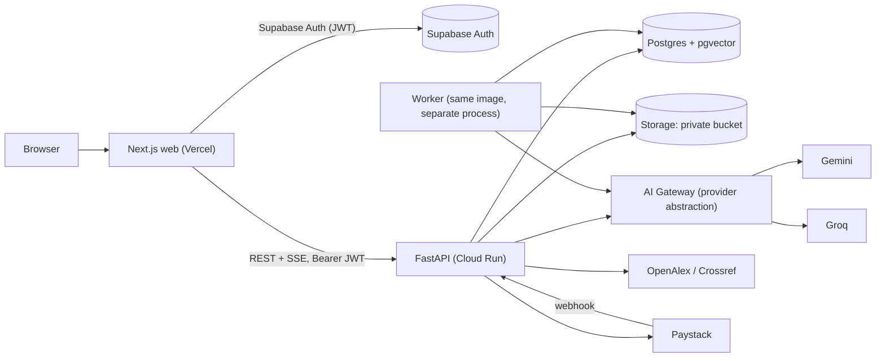

# Móyee — Stage 4: Technical Architecture

**Status:** Draft, recommended choices marked ✅ · **Depends on:** [03-ux-specification.md](./03-ux-specification.md) · **Next:** Detailed requirements (schema, API, tasks)

**Design drivers:** solo dev · 12 weeks · near-zero cost · global · provider independence (PRD §5.7) · strict data isolation (PRD §12.2).

---

## 1. Stack decisions

| Layer | Choice | Why / free-tier notes |
|---|---|---|
| Frontend | ✅ **Next.js 15 (App Router) + TypeScript** | PRD default. Deploys to Vercel Hobby for free |
| UI | ✅ **Tailwind CSS + shadcn/ui** | Accessible primitives (Radix), no licence cost |
| Editor | ✅ **Tiptap** (MIT core) | Custom citation node, selection menus |
| PDF viewer | ✅ **react-pdf** (pdf.js) | Page navigation + text-layer highlighting |
| Matrix grid | ✅ **TanStack Table** | Headless and editable |
| Backend | ✅ **Python 3.12 + FastAPI** | Best ecosystem for PDF parsing, CSL citations, DOCX |
| Database | ✅ **Supabase Postgres + pgvector** | Free: 500 MB DB. Row-level security as a second isolation layer |
| Auth | ✅ **Supabase Auth** | Email/password, verification, reset, Google later. Free up to 50k MAU. FastAPI verifies the JWT |
| File storage | ✅ **Supabase Storage** (private bucket) | Free 1 GB. S3-compatible. Signed URLs |
| Background jobs | ✅ **Postgres job table + worker loop** (`FOR UPDATE SKIP LOCKED`) | No Redis/Celery to run. Swappable for Celery later |
| LLM (chat, extraction) | ✅ **Google Gemini 2.5 Flash** (free tier) behind a provider abstraction · fallback **Groq (Llama 3.3 70B)** | Both free tiers. Rate limits handled by queue + fallback |
| Embeddings | ✅ **Gemini `gemini-embedding-001`**, 768 dims | Free tier. Dimension fixed in config |
| PDF extraction | ✅ **pypdfium2** (+ pdfplumber fallback) | Permissive licences (avoids PyMuPDF's AGPL in a SaaS) |
| Citations | ✅ **citeproc-py + official CSL styles** | APA 7, Harvard (Cite Them Right), IEEE |
| DOCX export | ✅ **python-docx** | |
| Academic data | ✅ **OpenAlex** (+ Crossref for DOI fallback) | Free, no key. Send `mailto` for the polite pool |
| Payments | ✅ **Paystack test mode** behind a `BillingProvider` interface | Stripe/Lemon Squeezy can be added later for global |
| API hosting | ✅ **Google Cloud Run** (free tier) · alt: Render free | Cloud Run scales to zero with a generous free tier. Needs a billing account on file. Render free sleeps after 15 min |
| Errors / monitoring | ✅ **Sentry** free tier + structured logs | |
| Repo | ✅ **Monorepo:** `apps/web`, `apps/api`, `docs/` | GitHub Actions CI (free) |

> [!WARNING]
> **Free-tier risks.** (1) Supabase free projects **pause after 7 days of inactivity**, so keep a weekly ping or demo regularly. (2) On Gemini's free tier, **submitted content may be used to improve Google's products**. The Privacy Policy must say so, and paid tiers (or a provider switch) are needed before a real public launch (PRD §12.5). (3) Free LLM rate limits (requests per minute) cap concurrent users, which is acceptable for a demo or small beta.

---

## 2. System architecture



- **The web app never talks to the database directly for app data.** All reads and writes go through FastAPI, which enforces ownership and quotas. Supabase JS is used **only for auth** (session handling) and for uploading directly to storage with a signed upload URL issued by the API.
- **Defence in depth:** FastAPI filters every query by `user_id`. RLS policies on every table mean even a leaked key can't read other users' rows.
- **Streaming:** assistant answers stream over Server-Sent Events.

---

## 3. Backend module layout (modular monolith)

```
apps/api/app/
  core/          config, db session, auth (JWT verify), errors, logging
  modules/
    users/       profile, account deletion
    projects/    CRUD, templates, archive
    discovery/   OpenAlex/Crossref clients behind AcademicProvider interface
    library/     sources, documents, uploads, dedupe
    ingestion/   extract → chunk → embed → index (worker jobs)
    retrieval/   hybrid search (pgvector + tsvector), ranking
    assistant/   conversations, RAG orchestration, citation validation
    literature/  matrices, extraction jobs
    writing/     research documents, sections
    references/  CSL data, citeproc rendering, BibTeX
    export/      DOCX, CSV, BibTeX
    billing/     plans, usage metering, entitlements, Paystack
  ai/            AIProvider interface, gemini.py, groq.py, router, token accounting
  jobs/          job queue + worker entrypoint
```

Each module has its own `router.py`, `service.py`, `models.py` and `schemas.py`. Modules talk to each other only through service functions, which keeps them extractable later (PRD §5.6).

---

## 4. AI provider abstraction

```python
class AIProvider(Protocol):
    async def generate(self, req: GenerateRequest) -> GenerateResponse: ...
    def stream(self, req: GenerateRequest) -> AsyncIterator[StreamChunk]: ...
    async def embed(self, texts: list[str], task: EmbedTask) -> list[list[float]]: ...
```

- `AIRouter` picks a provider and model per **task type** (`chat`, `extract`, `summarise`, `rewrite`, `embed`) from config. On a 429 or 5xx it retries with backoff, then falls back to the next provider.
- Every call writes an `ai_usage` row (user, task, provider, model, input/output tokens, latency, cost estimate).
- **Embeddings are not swappable at runtime** (the vector space would change). Changing the embedding model means re-embedding, tracked by an `embedding_model` column on each chunk.

---

## 5. Ingestion pipeline

1. `POST /documents/upload-url` checks quota + size, creates a `document` (status `pending_upload`), and returns a signed upload URL.
2. The client uploads to storage, then calls `POST /documents/{id}/complete`.
3. The API checks magic bytes (`%PDF-`), page count ≤ 300 and SHA-256 dedupe, then enqueues an `ingest_document` job.
4. The worker: extracts text per page with pypdfium2 → stores `document_pages` → if the average is < 50 chars/page, marks the document `failed: scanned`.
5. Chunking: ~800 tokens with 120 overlap, **never crossing page boundaries without recording `page_start`/`page_end`**. It also keeps the character offsets used for highlighting.
6. Embeds in batches (rate-limited), writes `document_chunks.embedding` and the `tsvector`.
7. Status becomes `ready`, a progress % is updated throughout, and the UI polls every 3 s (no websockets needed).

Saved OpenAlex records: title + abstract becomes a single chunk (`page = null`, source type `abstract`), so they're searchable and citable as "abstract".

---

## 6. RAG + citation integrity

1. Resolve scope → the set of `source_id`s the user owns within the project.
2. Hybrid retrieval: top 20 by vector cosine + top 20 by `ts_rank`, merged with reciprocal rank fusion, keeping the top 8 (budgeted to about 6k tokens).
3. If the best similarity is below the threshold → return the **insufficient evidence** response (the model is still allowed to give a labelled general explanation).
4. Prompt: system rules + project context (topic, questions) + passages as `<source id="S3" doc="…" page="7">…</source>`, **marked as untrusted data, with instructions inside it to be ignored**.
5. The model must return answer text with `[S3]` markers plus a separate `interpretation` section.
6. **Validator:** any marker not in the retrieved set is removed and logged. Markers are renumbered to `[1]..[n]` and mapped to `{doc, page, snippet, char offsets}`.
7. Persist the message along with the `message_citations` rows (an audit trail of what evidence was shown).

The same validator is used for summaries and matrix extraction (each cell stores the `chunk_id` it came from, or "Not reported").

---

## 7. Quotas & billing

- `plans` table (limits as JSONB), `subscriptions`, `usage_counters(user_id, metric, period_start, count)`.
- An `require_quota("assistant_messages")` FastAPI dependency increments the counter atomically (`UPDATE … WHERE count < limit RETURNING`) and returns 402 with `{metric, limit, resets_at}` when the limit is hit.
- Paystack: `initialize transaction` → hosted checkout → webhook (HMAC-SHA512 verified) → subscription `active`. The `BillingProvider` interface keeps Stripe and others pluggable.

---

## 8. Security baseline

JWT verification (Supabase JWKS) on every request · ownership checks in the service layer · RLS on all tables · private bucket + 5-minute signed URLs · upload validation · rate limiting per user (slowapi) · CORS locked to the web origin · secrets only in env vars · no document content in logs · Paystack webhook signature check · cross-user isolation test suite in CI.

---

## 9. Environments & delivery

| Env | Web | API | DB |
|---|---|---|---|
| Local | `next dev` | `uvicorn` + worker | Supabase CLI (local Docker) or a free cloud dev project |
| Production | Vercel | Cloud Run (api + worker services, one image) | Supabase free project |

CI (GitHub Actions): lint + typecheck + tests on every PR, auto-deploy `main`.

---

## 10. Things to set up (you, with free accounts)

1. GitHub repo
2. Supabase project (gives the DB, Auth and Storage keys)
3. Google AI Studio API key (Gemini)
4. Groq API key (fallback)
5. Vercel account (link to GitHub)
6. Google Cloud project for Cloud Run (or Render)
7. Paystack account (test keys only)
8. Sentry (optional, week 11)

Only 1–3 are needed to start week 1.
